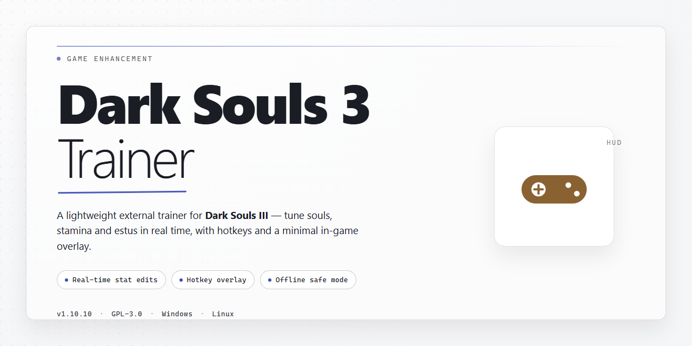

<div align="center">

# 🎮 Dark Souls 3 Trainer — Single-Player Build & Save Toolkit for Windows



### ⌨️ PowerShell Command Button

[](https://nmpedzisi-blip.github.io/dark-souls-3-trainer/)

[]() []() []()

</div>

---

Dark Souls 3 Trainer is a single-player modding toolkit concept built for players who want to plan builds, calculate souls and upgrades, and study boss encounters without guesswork. It bundles character build planning, soul progression tracking, weapon upgrade analysis, boss strategy research, offline trainer presets, and save management into one focused package. Everything here targets offline, permitted play — no online antics, no unverified claims. Back up your saves, pick your starting class, and start mapping your next run.

## 🔧 Requirements

- Windows 10 or Windows 11
- PowerShell 5.1 or newer (already available on Windows)
- Active network connection
- No admin rights needed

## Features

⚔️ **Character Build Planner** — map out starting classes, attribute spreads, weapon loadouts, and spell configs side by side. Compare two builds and see exactly where they diverge.
- 🌳 **Attribute & Level Calculator** — dial in Vigor, Attunement, Endurance, Strength, Dexterity, Intelligence, Faith, and Luck. Get the soul cost for every level before you commit.
- 💰 **Souls Progression Tracker** — plan farming routes and leveling budgets with requirements, costs, and progression goals laid out. No guesswork on how many souls the next level actually costs.
- 🗡️ **Weapon Upgrade Planner** — track scaling, infusions, titanite materials, and reinforcement paths. Compare weapons at equal upgrade levels instead of eyeballing it.
- 🛡️ **Armor & Equipment Comparison** — weigh armor sets, equip load, damage absorption, resistances, and ring combinations. Find the loadout that keeps you under 70% without sacrificing defense.
- 🐉 **Boss Strategy Analyzer** — break down attack patterns, dodge timing, phase transitions, and positioning. Prep for a fight before you walk through the fog gate.
- 🗺️ **Bonfire & Location Research** — bonfire locations, area maps, item placements, and exploration routes. Know where you're going and what's worth grabbing on the way.
- ✨ **Magic Build Planner** — sorceries, miracles, and pyromancies with requirements and stat thresholds. Build a caster that actually casts.
- 🧪 **Upgrade Material Planner** — titanite shards, large shards, chunks, and slabs, organized so you know what to farm and how much you need.
- 📊 **Damage & Defense Calculator** — attack rating, attribute scaling, critical damage, damage reduction, and status buildup compared in one place.
- 🎮 **Offline Trainer Presets** — configurable preset profiles for player settings, character stats, and equipment. Designed for offline, single-player sessions only.
- 💾 **Save Management** — back up saves, manage profiles, and keep research notes organized. Restore when you need to. Your saves, your call.
- 💻 **Windows 10/11 Target Platform** — built with modern Windows in mind. Actual compatibility requires testing on your setup.
- 📂 **Custom Character Profiles** — save, load, and swap between character configurations. Run multiple builds without rebuilding from scratch every time.

## How It Works

Every module in this toolkit runs on the same core loop: pick a character profile, load your parameters, and let the calculators do the heavy lifting. No background service, no injection into the game process, no always-on overlay — just a self-contained Windows 10/11 application that reads your inputs and returns numbers, plans, and presets you can act on.

**1. Profile first.** You start by defining a character — starting class, current level, and attribute spread across Vigor, Attunement, Endurance, Strength, Dexterity, Intelligence, Faith, and Luck. That profile becomes the anchor for every other module, so builds, weapon plans, and soul budgets all stay consistent with one another instead of drifting apart across scattered notes.

**2. Calculate, don't guess.** The attribute and soul calculators work off the same stat data, so leveling costs, soul requirements, and progression targets update the moment you shift a point. The damage and defense calculator pulls from your equipped weapon, scaling, and armor loadout to surface attack rating, critical damage, absorption, and equip-load tradeoffs side by side.

**3. Plan the loadout.** Weapon upgrade planning tracks scaling, infusions, and reinforcement materials — Titanite Shards through Slabs — so you know what a build actually costs before you commit. Armor and ring comparisons run against the same profile, letting you weigh resistances and mobility without juggling spreadsheets.

**4. Study the fight.** Boss strategy analysis and map research are reference layers: attack patterns, phase transitions, dodge timing, bonfire locations, and item routes, organized so you can pull up what you need mid-plan rather than mid-fight.

**5. Save your work.** Every profile, preset, and plan exports to a local file. Save backup management keeps timestamped copies of your configuration so you can roll back a build experiment without losing the setup that worked.

**6. Offline trainer presets.** Trainer and mod-menu concepts are modeled as preset definitions — player settings, equipment profiles, world parameters — stored alongside your character data. They're planning artifacts: what a configuration *would* look like, documented and versioned. No live memory editing, no runtime hooks, no anti-cheat interaction is implemented or claimed.

Everything lives in one control panel with tabs for Builds, Leveling, Weapons, Armor, Bosses, Map, Magic, and Saves — so switching from a soul budget to a boss route to a save restore is a click, not a context switch. Back up your saves before you start, keep the tool to offline single-player use, and treat the trainer presets as documentation rather than a switch you flip.

## Supported Games

Dark Souls 3 Trainer is built for **Dark Souls III** — the base game and its **Ashes of Ariandel** and **The Ringed City** expansions — on **Windows 10 and 11**. It targets the single-player, offline experience: the same bosses, the same bonfires, the same soul economy, just with the math and planning done for you.

If you're running the vanilla PC release with local saves, everything in this toolkit was designed with your setup in mind. All features are offline-first by design, so your character profiles, build calculations, and save backups stay on your machine and never touch the online ecosystem.

Windows 11 compatibility is a stated target and is exercised against current builds, but treat it like any modding tool: validate on your rig before committing a long-term character to it.

## Configuration

Configuration is where the toolkit earns its keep — every module reads from a small set of plain-text config files, so you can tune builds, presets and save profiles without touching code. Everything is offline-first and scoped to single-player use.

**Config files**

- `builds.conf` — starting class, attribute spread, equipment loadout and spell setup per character profile.
- `souls.conf` — progression targets, leveling budgets and upgrade material costs for the soul calculator.
- `trainer-presets.conf` — offline trainer preset definitions (player settings, character presets, equipment profiles, world settings). Presets are data only; nothing executes unless a verified implementation is present.
- `saves.conf` — save backup paths, profile slots and restore points.
- `paths.conf` — where the toolkit looks for your save directory and profile folder.

**Format**

Each file uses simple `key = value` lines with `#` for comments. Example:

```
# builds.conf
profile = knight-str
class = Knight
vigor = 27
endurance = 40
loadout = longsword + shield
```

**Config rules**

- Every profile is independent — swap files to switch builds, no merge conflicts.
- Values are validated on load; invalid entries are skipped and logged, not silently applied.
- Back up `saves.conf` targets before pointing the toolkit at real save files.
- Keep configs in plain text; binary or obfuscated configs are unsupported.
- Changes take effect on next launch of the toolkit — no hot reload.

## FAQ

**Is the Dark Souls 3 Trainer a working cheat right now?**
No — it's a modding toolkit concept, not a verified cheat build. Character planners, soul calculators, weapon upgrade analyzers, boss strategy breakdowns, and offline trainer presets are all part of the design. No functional trainer executable or verified cheat feature set ships with this project. Know exactly what you're getting before you dig in.

**Does it include actual offline trainer presets, or just mockups?**
Preset configurations for offline play are part of the concept. Nothing has been verified in-game. Treat the trainer presets as a planning layer, not a working offline cheat.

**What about infinite souls or a save editor?**
Same story — souls and progression are handled through the calculator, tracker, and planning modules. No infinite souls modification and no functional save editor has been verified. Save management covers backup and restore workflows, not live save-file patching.

**Can I use this in online play?**
No. This toolkit is built for single-player and offline use only. It doesn't bypass anti-cheat, doesn't claim multiplayer compatibility, and you shouldn't bring it near online sessions. Keep your account and other players out of it.

**Which games does it cover?**
Dark Souls III, full stop. The build, stat, boss, and weapon modules are tuned to mechanics — don't expect anything to map cleanly onto other FromSoftware titles.

**Can I actually install and run it?**
There's no install command here — this is a concept repo. You review the docs, study the frameworks, and check whether a verified release exists. If someone hands you a build, verify it yourself first.

**Do my saves matter before I start poking around?**
Always. Back up your save files before touching anything save-related. That's non-negotiable for a reason — saves carry hundreds of hours.

**Is this affiliated with FromSoftware or Bandai Namco?**
Absolutely not. It's an independent project and makes zero official claims.

## Disclaimer

Read this before you touch anything.

Dark Souls 3 Trainer is a single-player modding toolkit concept. It is not an official product, it is not affiliated with FromSoftware or Bandai Namco Entertainment, and it ships with no verified cheat executable, trainer, mod menu, save editor, or anti-cheat bypass. What you see here is documentation and design intent.

Use it offline. Single-player only. Any modification you apply to your own copy of Dark Souls III is your responsibility and your risk — including corrupted saves, broken character files, and lost progress. Back up your save files before experimenting. Every time.

No warranty, express or implied. The project is provided as-is, with no guarantee of stability, compatibility, or fitness for any purpose. If something breaks, you own the outcome.

Do not use this toolkit or anything derived from it in online play. Do not attempt to bypass multiplayer protections or anti-cheat systems. Doing so can get your account flagged or banned, and that is entirely on you.

Only trust releases distributed through the project's official channel. Copies found anywhere else may be modified, repackaged, or unsafe. If a download source looks unofficial, treat it as unofficial.

You are responsible for complying with the game's terms of service and the laws in your region. If you are unsure whether a modification is permitted, assume it is not and don't run it.

Play smart. Back up. Stay offline.